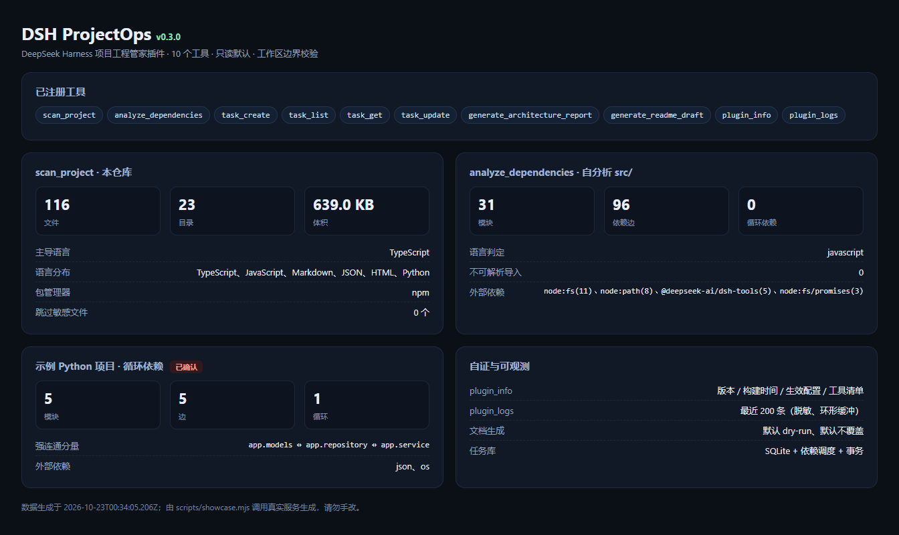
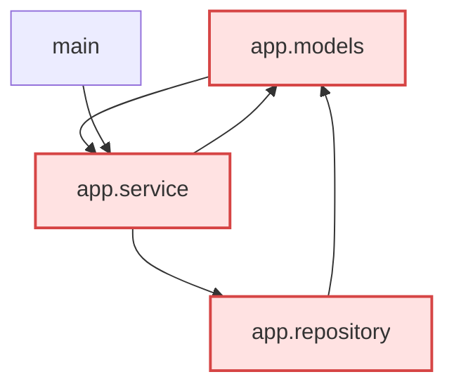

# DSH ProjectOps

一个运行在 [DeepSeek Harness](https://harness.deepseek.com)（DSH）里的项目工程管家插件。
目标是把「看懂一个项目」变成模型可以可靠调用的能力：**扫描结构 → 分析依赖 → 管理任务 → 生成架构文档**。

- 只读：扫描与依赖分析都不修改你的源码。
- 有边界：所有文件访问都必须落在授权工作区内，路径穿越与符号链接逃逸都会被拒绝。
- 有节制：默认排除 `.git`、依赖缓存、构建产物，并不列出、不读取、不记录 `.env` 等敏感文件。
- 说实话：静态解析能确认的说成"已确认"，推测的说成"启发式"，两者在输出里分开标注。



> 上图由 `docs/images/preview.html` 渲染，数据全部来自本会话对真实仓库的工具调用（扫描、自分析 src/、示例项目的循环依赖）。

## 当前进度

| 阶段 | 内容 | 状态 |
| --- | --- | --- |
| 一 | 环境/API 核查、插件骨架、可加载可调用的 `scan_project` | ✅ 完成（真实 cordis + dsh-tools + 真实 PluginLoader 挂载验证） |
| 二 | 目录扫描完善（隐藏项/自定义排除/目录汇总）、扫描缓存、路径校验与异常隔离 | ✅ 完成 |
| 三 | 依赖分析（Python + TypeScript/JavaScript）、循环依赖（强连通分量）、Mermaid 架构图 | ✅ 完成 |
| 四 | SQLite 任务管理（任务/状态/执行记录） | ✅ 完成（node:sqlite，无需 native 依赖） |
| 五 | Markdown 架构报告 / README 初稿生成（dry-run + 防覆盖） | ✅ 完成 |

测试规模：**116 个用例全绿**（单元 + 宿主组合 + 真实 Loader 加载路径）；其中 **92 个**不依赖 DSH 安装，CI 跑这一批（`npm run test:ci`，工具层用 mock dsh-tools 契约替身），语句覆盖率基线 **82.48%**。

## 5 分钟上手

```bash
cd dsh-projectops
npm run build          # 用 Node 内建类型擦除把 src 编译到 lib
npm test               # 55 个测试
npm run demo           # 扫描本仓库
npm run demo:analyze   # 分析 examples/sample-python-app（含真实循环依赖）
npm run demo:report    # 生成 examples/sample-python-app/docs/architecture.md
npm run bootstrap:tooling  # 无 npm 的机器：下载解包 typescript/@types/node（解包到 node_modules）
npm run typecheck      # tsc --noEmit（只检 src/，0 error 才算过）
npm run verify         # 一键自检：构建 + typecheck + 全量测试 + CI 子集 + 三个 demo
npm run lint           # 离线原生 lint（可擦除语法/console/any/tab/行尾空白）
npm run check:coverage # 覆盖率门槛（默认 statements ≥ 80%）
npm run test:ci        # 无 DSH 环境也能跑（含工具层契约测试）
# 本机装有 DSH 时，想复现 CI（强制使用 mock 替身）：
#   Linux/macOS: DSH_FORCE_MOCK=1 npm run test:ci
#   Windows:     set DSH_FORCE_MOCK=1 && npm run test:ci
node scripts/check-metadata.mjs   # 发布前元数据自检
node scripts/showcase.mjs         # 用真实调用重新生成效果图页面
```

> 测试会用 `tests/support/runtime-hooks.mjs` 把 `@deepseek-ai/*` 指向本机已安装的 DSH 运行时；
> 自动探测失败时设置 `DSH_RUNTIME_DIR=<...>/resources/app.asar/dsh/node_modules`。
>
> 这台机器上只有 DSH 自带的 Node（PATH 里没有 node/npm），等价命令是：
> `ELECTRON_RUN_AS_NODE=1 "<DSH 安装目录>/DeepSeek Harness.exe" scripts/build.mjs`。

## 工具

### scan_project

| 参数 | 类型 | 说明 |
| --- | --- | --- |
| `path` | string | 要扫描的目录。相对路径按会话工作区解析；省略则扫描工作区根。必须在授权工作区内。 |
| `maxDepth` | integer | 目录树最大深度，1–32，默认 6。 |
| `maxEntries` | integer | 最多遍历条目数，1–200000，默认 5000。 |
| `includeHidden` | boolean | 是否把点开头的隐藏项计入结果，默认 false。 |
| `includeTree` | boolean | 是否返回目录树文本，默认 true。 |

返回：`root / authorizedRoots / detection / stats / directorySummary / tree / truncated / cached / warnings / durationMs`。

### analyze_dependencies（Python / TypeScript-JavaScript）

| 参数 | 类型 | 说明 |
| --- | --- | --- |
| `path` | string | 要分析的 Python 项目目录（默认工作区根）。 |
| `maxFiles` | integer | 最多分析的 `.py` 文件数，默认 2000。 |
| `maxFileBytes` | integer | 单文件读取上限，默认 256 KB。 |
| `language` | enum | `auto`（默认）/ `python` / `javascript`：显式指定或按文件数自动选择。 |

支持 **monorepo 跨包解析**（根 `package.json` 的 `workspaces`，能解析 `@demo/lib` 这类工作区包名）与 `tsconfig.json` 的 `compilerOptions.paths` / `baseUrl` 别名（含注释与尾逗号的容错解析）：命中别名但文件不存在时记为 `unresolved`，不会被误算成外部依赖。
| `includeMermaid` | boolean | 是否返回 Mermaid 架构图，默认 true。 |
| `includeExternal` | boolean | 是否返回外部依赖统计，默认 true。 |

返回：`stats / modules / edges / cycles / external / unresolved / mermaid / truncated / warnings`。

示例（`npm run demo:analyze` 的真实输出，节选）：

```text
modules  : 5 | edges: 5 | cycles: 1
edges    : app.service -> app.repository, app.service -> app.models, app.repository -> app.models, main -> app.service ...
cycles   : ! app.models <-> app.repository <-> app.service
external : json(1), os(1)
```



### 任务管理（task_create / task_list / task_get / task_update）

任务与执行记录存放在工作区的 `.projectops/tasks.db`（SQLite，`node:sqlite` 内置驱动，无需 native 依赖）。

| 工具 | 作用 | 主要参数 |
| --- | --- | --- |
| `task_create` | 创建任务 | `title`（必填）、`description`、`priority`、`dependsOn` |
| `task_list` | 列任务 + 各状态计数 | `state`、`limit` |
| `task_get` | 任务详情 + 执行记录 | `id`、`executionLimit` |
| `task_update` | 改状态/字段并自动记执行记录 | `id`、`state`、`message`、`errorCode` |

状态：`pending` / `in_progress` / `completed` / `failed`。**依赖调度**：`dependsOn` 里任一前置未 `completed` 时，推进到 `in_progress`/`completed` 会被拒绝（`TASK_DEPENDENCY_UNMET`）；状态变更与执行记录在**同一事务**内提交。进入 `in_progress` 时 `attempts + 1`；
`failed` 时把 `message` 记进 `lastError`（写入前自动脱敏）。`dependsOn`/`attempts`/`lastError` 是为任务依赖与失败重试预留的字段。

### 多语言文案（locale）

工具描述与参数说明来自 `locale/zh.json` / `locale/en.json`，配置项 `locale: auto | zh | en`（默认 auto：配置 → 环境变量 → 系统区域（Intl）→ 英文）。
测试强制两套目录**键集合完全一致**，并校验 10 个工具的描述与每个参数都有文案——漏译会直接挂测试。

### 加载诊断（v0.7.2+）

插件 `apply` 成功后会写一个**加载信标** `<repo>/.projectops/last-load.json`（版本、时间、工具数、locale、pid）。
宿主在加载失败时会静默 sanitize profile（把 `cordis.patch.yml` 备份成 `*.bak-<ts>`、重写 bundles），
此时用信标就能区分两种失败：

- 信标**没有**更新 → 宿主根本没加载这一版（清单 / compose / patch 层问题）
- 信标更新了但工具不在 → 加载成功，是注册或可见性问题

安装只需要三件事：profile `package.json` 的依赖、`dsh.profile.bundles` 里的条目、以及指向仓库的目录联接。
**不需要**改 profile 的 `cordis.patch.yml`——宿主会按 bundle 读包内的 `cordis.patch.yml`（实测确认）。

### 依赖锁定

`package-lock.json` 已提交（lockfileVersion 3，含 `resolved` 与 `sha512` integrity）；CI 用 `npm ci` + npm 缓存。
本机没有 npm 时，可以 `node scripts/bootstrap-tooling.mjs` 手动引导 typescript 到 node_modules 再跑 typecheck。

### GUI 卡片（客户端视图层）

`src/client/index.ts` 导出数据驱动的卡片描述（`createToolViews()` + `apply(ctx)`，`platform: 'web'`），
由 DSH 客户端渲染；本仓库只保证**描述协议**：10 个工具全覆盖、字段来源合法、dry-run 等状态带 `attention` 标记。
真正的像素级渲染需要在装有 DSH 客户端的机器上验证。

### 版本对账与调用日志（P0）

- `plugin_info` 前几行就是 `加载自`（file URL）+ `构建产物时间` + `本次挂载时间`；
  **磁盘构建比本次挂载更新时直接返回 `staleBuild: true` 并在渲染里给出警告**——不用再靠猜。
- 每次工具调用都会写一条日志（工具名、耗时、成功/失败、错误码、少量计数字段），
  **不记录参数值、文件内容或输出正文**；用 `plugin_logs` 查。
- 改完代码后：**完全重启 DSH，或改动 `cordis.patch.yml` 里该条目触发重新加载**；否则宿主仍跑旧代码。

### 自证与可观测（plugin_info / plugin_logs）

| 工具 | 作用 |
| --- | --- |
| `plugin_info` | 版本、构建产物时间、本次挂载时间、运行环境、生效配置、已注册工具清单 —— **升级后先用它确认宿主里生效的是哪一版** |
| `plugin_logs` | 最近 200 条日志（环形缓冲、密钥已脱敏）。插件默认不写 stderr，排查问题时用它 |

### 文档生成（generate_architecture_report / generate_readme_draft）

| 工具 | 默认输出 | 关键默认值 |
| --- | --- | --- |
| `generate_architecture_report` | `docs/architecture.md` | `dryRun=true`、`overwrite=false`、`analyzeDependencies=true` |
| `generate_readme_draft` | `README.generated.md` | `dryRun=true`、`overwrite=false` |

报告固定 8 节：项目概览 / 目录结构 / 模块与职责 / 依赖关系（含 Mermaid）/ **已确认的问题** / **启发式观察** / 改进建议 / 附录。
「已确认」来自 import 解析（循环依赖、未解析导入），「启发式」来自文件名与规模统计 —— 两者在输出里分开列。

写入策略：默认 dry-run 只返回计划与预览；目标已存在且未传 `overwrite=true` 时**拒绝覆盖**并说明原因；真正写入用「临时文件 + rename」。
示例产物见 `examples/sample-python-app/docs/architecture.md`。

### 结论分层（重要）

- **静态可确认**：`edges`（解析出的 import 关系）与 `cycles`（依赖图的强连通分量）。
- **启发式**：`external`（解析不到项目内的导入名）、`unresolved`（越界的相对导入）、语言/入口/配置识别。
- 解析是**词法级**：不执行代码、不构建 AST，动态导入（`importlib`、`__import__`）不会被识别。

## 在 DSH 里安装

插件是标准 DSH bundle：`package.json` 的 `dsh.bundle.patch` 指向 `cordis.patch.yml`，加载后向 `ctx.tools` 注册工具。

```bash
node scripts/install-into-profile.mjs            # dry-run：只打印计划
node scripts/install-into-profile.mjs --apply    # 写入（自动备份 package.json / cordis.patch.yml）
node scripts/install-into-profile.mjs --rollback # 回滚
```

写入后必须**完全退出并重启 DSH**，新会话才会出现 `scan_project` 与 `analyze_dependencies`。

> 如果 DSH 启动异常（极小概率），可以用 DSH 自带的 Node 执行回滚，不依赖系统 node：
> `set ELECTRON_RUN_AS_NODE=1 && "<DSH 安装目录>\DeepSeek Harness.exe" "<本仓库>\scripts\install-into-profile.mjs" --rollback`

## 安全模型

1. **默认只读**：扫描与依赖分析都没有写文件的代码路径。
2. **授权工作区**：`WorkspaceGuard` 是唯一文件访问入口。先做词法越界检查（`../` 永远得到"越界"而不是"不存在"），再对 realpath 检查一次（挡住符号链接逃逸）。
3. **敏感文件**：`.env*`、`*.pem`、`*.key`、`id_rsa*`、`credentials*`、`.npmrc` 等既不出现在目录树，也不会被读取；只统计"跳过 N 个"。
4. **不跟随符号链接**：扫描器只把链接当成条目，不进入链接目标。
5. **日志脱敏**：键名命中 `token/secret/password/apiKey/...` 时值替换为 `[redacted]`；日志不写文件内容。
6. **失败可解释**：错误带稳定错误码；单个目录/文件失败只产生告警，不中断整体分析。

## 目录结构

```text
dsh-projectops/
├── src/
│   ├── index.ts                    入口：Config / apply / 装配两个工具
│   ├── tools/                      scan-project.ts、analyze-dependencies.ts
│   ├── services/                   project-scanner、scan-cache、language-detect、
│   │                               python-imports、dependency-analyzer、mermaid-renderer
│   ├── adapters/                   fs-adapter（FsPort）、source-reader（读源码端口）
│   ├── storage/                    task-store（接口）、sqlite-task-store（node:sqlite）
│   ├── security/                   workspace-guard、excludes
│   ├── util/                       errors、logger、text
│   └── types.ts                    领域模型
├── tests/                          单元 + 宿主组合 + 真实 Loader 加载路径
├── scripts/                        build / demo-scan / demo-analyze / install-into-profile
├── examples/sample-python-app/     带真实循环依赖的示例项目
├── docs/                           architecture.md、dev-log.md
├── cordis.patch.yml                DSH bundle patch
├── dsh.plugin.json                 插件清单
├── .github/                       CI 工作流 + issue/PR 模板
├── LICENSE / CONTRIBUTING / SECURITY / CODE_OF_CONDUCT / CHANGELOG
```

文档：[用法手册](docs/usage.md)（八个工具的真实调用样例） · [架构说明](docs/architecture.md)（含 Mermaid 图） · [排错手册](docs/troubleshooting.md) · [开发记录](docs/dev-log.md)。

## 发布到 GitHub（三步）

```bash
node scripts/configure-repository.mjs https://github.com/<你>/dsh-projectops   # 写入 repository/homepage/bugs、替换徽章占位符
git remote add origin https://github.com/<你>/dsh-projectops.git               # 首次
git push -u origin main && git push --tags
```

上传前自检：`npm run check:publication` —— 会拦截本机绝对路径、疑似密钥、占位符，以及误跟踪的 `lib/` / `node_modules/` / `.projectops/`。
CI 里的 `metadata strict` 步骤同样会在占位符未替换时失败。

## 参与与开源

- 许可证：[MIT](LICENSE)
- 贡献指南：[CONTRIBUTING.md](CONTRIBUTING.md)（含「新增一个工具的最小步骤」）
- 安全策略与安全模型：[SECURITY.md](SECURITY.md)（漏洞请走私下渠道）
- 行为准则：[CODE_OF_CONDUCT.md](CODE_OF_CONDUCT.md)
- 版本记录：[CHANGELOG.md](CHANGELOG.md)（Keep a Changelog + SemVer）
- 英文说明：[README.en.md](README.en.md)
- CI：`.github/workflows/ci.yml` 在 Ubuntu/Windows × Node 22/24 上跑构建、`test:ci` 与 demo

> 发布到 npm 前把 `package.json` 里的 `repository` / `homepage` / `bugs` 换成你的仓库地址（当前是占位符 `<你的 GitHub 账号>`）。

## 已知限制
- 依赖分析是词法级静态解析（动态导入、拼接出来的模块名识别不到）；混合仓库一次只分析一种语言（返回 `mixedProject` 标记）。
- 语言/入口/配置识别基于文件名与扩展名，不理解语义。
- 扫描是单线程递归；超大仓库靠 `maxDepth`/`maxEntries` 兜底。
- 构建用 Node 自带类型擦除，**不做类型检查**；需要类型检查时另装 typescript 加 `tsc --noEmit`。
- 报告落盘与 README/架构文档生成还没做（第五阶段）；
- 任务依赖只存字段，还没有「依赖未完成就拒绝执行」的调度逻辑（2026-10 补齐：拒绝推进 + 事务 + `busy_timeout` + `PRAGMA user_version` 迁移入口）。

## License

MIT
