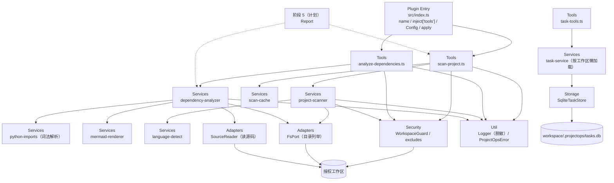
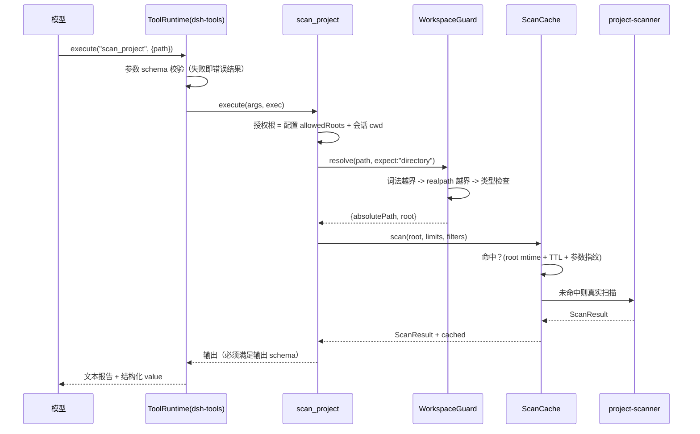
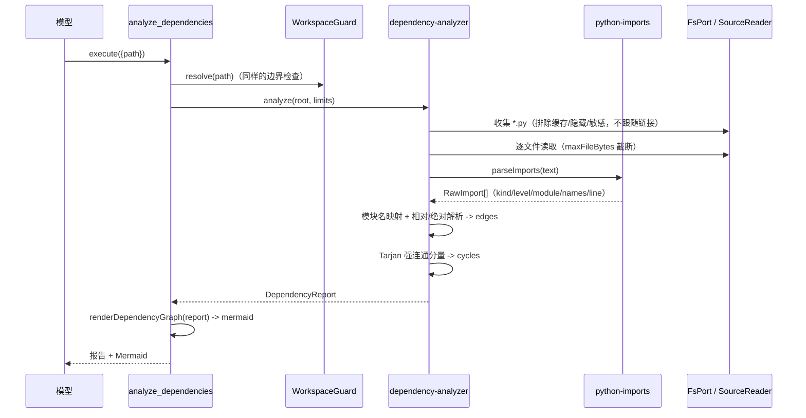
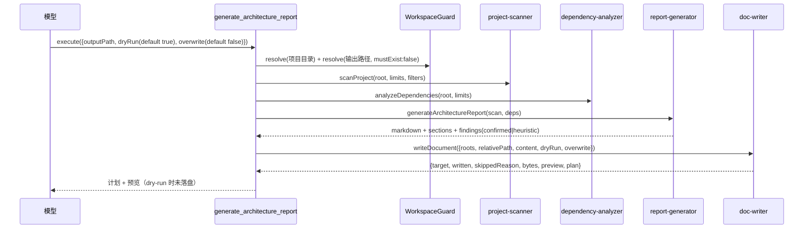

# 架构说明（第一 ~ 三阶段）

## 分层



| 层 | 职责 | 为什么需要 |
| --- | --- | --- |
| Plugin Entry | 插件契约、配置归一化、装配与卸载清理 | 配置错误在挂载阶段暴露；工具共享同一份 logger/cache |
| Tools | 参数与输出 schema、渲染、错误到结果的转换 | 模型输入要校验、输出要可机读；不含业务逻辑 |
| Services | 扫描、缓存、语言识别、import 解析、依赖图、Mermaid | 纯逻辑，可单测，不依赖宿主 |
| Adapters | `FsPort` / `SourceReader` | 测试可注入"某目录抛 EACCES""某文件读失败"的替身 |
| Security | 路径授权、排除规则 | 安全逻辑集中一处 |
| Util | 统一错误码、脱敏日志 | 可调试且不泄漏 |

## 两条主链





## 关键接口

```ts
interface WorkspaceGuard {
  readonly roots: readonly string[]
  contains(candidate: string): boolean
  resolve(requested: string, options?: ResolveOptions): ResolvedTarget
}

interface FsPort { listDirectory(dir: string): Promise<FsEntry[]> }
interface SourceReader { readTextFile(path: string, maxBytes: number): Promise<SourceChunk> }
interface ScanCache { scan(request: ScanRequest): Promise<CachedScanResult>; clear(): void; readonly size: number }
```

## 依赖分析算法要点

1. **模块命名**：`pkg/a.py -> pkg.a`，`pkg/__init__.py -> pkg`，根级 `__init__.py -> __root__`。
2. **解析顺序**：
   - 绝对导入：先精确匹配，再逐级退到父包（`a.b.c -> a.b -> a`）；
   - `from x import y`：先试 `x.y`，再试 `x`；
   - 相对导入：从导入文件所属包开始，按层级回退后拼接模块名，越界记为 `unresolved`。
3. **循环依赖**：对项目内模块图跑迭代版 Tarjan，输出所有强连通分量（含自环）。这是静态可确认的结构事实，不是猜测。
4. **复杂度**：O(V+E) 建图与找环；文件读取受 `maxFiles`/`maxFileBytes` 限制。

## 错误模型

| code | 场景 | 表现 |
| --- | --- | --- |
| `PATH_OUTSIDE_WORKSPACE` | `../`、绝对路径越界、符号链接逃逸 | 拒绝执行并说明授权根 |
| `NOT_FOUND`/`NOT_A_DIRECTORY`/`NOT_A_FILE` | 目标不存在或类型不符 | 明确告知期望类型 |
| `PERMISSION_DENIED` / `READ_FAILED` | EACCES/EPERM/其它 I/O | 目录/文件级降级为 warning，分析继续 |
| `INVALID_PATH` | 空路径、含 NUL、无法解析 | 拒绝执行 |

## 任务存储要点

```text
tasks(id, title, description, state, priority, depends_on JSON, attempts, created_at, updated_at, last_error)
task_executions(id, task_id -> tasks.id ON DELETE CASCADE, state, started_at, finished_at, message, error_code)
```

- 每个工作区一个库文件，服务按绝对路径缓存 `TaskStore`；插件卸载时 `closeAll()`。
- 所有写操作参数绑定，不拼 SQL；`message` / `lastError` 落库前脱敏。
- 状态机：`pending -> in_progress -> completed | failed`，每次变更追加执行记录（`attempts` 在进入 in_progress 时 +1）。

## 文档生成流水线



写入规则（`src/adapters/doc-writer.ts`）：

1. 输出路径必须过 `WorkspaceGuard.resolve(..., { mustExist: false })`；
2. `dryRun=true` 时只返回 `plan` + `preview` + `bytes`，不产生任何文件；
3. 目标已存在且 `overwrite=false` 时返回 `skippedReason`，绝不静默覆盖；
4. 真正写入：`mkdir -p` 父目录 → 写 `.<random>.tmp` → `rename` 覆盖，避免半成品文件。

## 依赖分析：语言路由

```text
analyze_dependencies(language: auto|python|javascript)
        |
        v
dependency-service: 用 source-files 收集 .py 与 .ts/.tsx/.js/.jsx/.mjs/.cjs 文件数
        |-- auto            -> 文件数多的一方
        |-- 显式指定         -> 该语言；若该语言为 0 文件 -> 退回另一方
        v
python: dependency-analyzer (import/from-import, 相对点数语义)
js:     js-dependency-analyzer (相对路径 + 扩展名候选表 + 目录 index; 裸模块名 -> external)
        |
        v
同一套 DependencyReport（modules / edges / cycles / external / unresolved）
+ findCycles（共用 Tarjan）+ mermaid-renderer（共用渲染）
```

**为什么要分语言分析而不是合并成一张图**：Python 的 `app.models` 与 TS 的 `src/models` 是两套命名空间，
硬合并会造出并不存在的"跨语言循环依赖"。混合仓库返回 `mixedProject: true`，由调用方决定是否带 `language` 再跑一次。

## 扩展点

- **任务管理（阶段 4）**：`storage/task-store.ts` 定义接口（create/list/get/update/recordExecution），`storage/sqlite-task-store.ts` 实现；数据库放工作区内 `.projectops/tasks.db`（已 gitignore）。预留 `dependsOn`、`attempts` 字段给任务依赖与失败重试。
- **报告生成（阶段 5）**：`services/report-generator.ts` 消费 ScanResult + DependencyReport + 任务数据生成 Markdown；写文件前用 `guard.resolve(path, {mustExist:false})` 校验并默认不覆盖已有文件。
- **更多语言**：新增 `services/<lang>-imports.ts`，复用同一张依赖图与 Mermaid 渲染。
