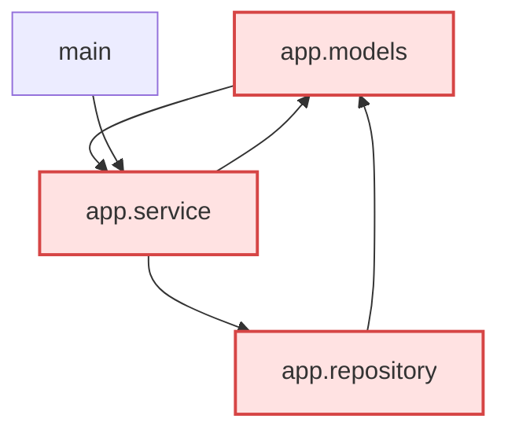

# sample-python-app 架构说明

> 由 dsh-projectops 自动生成于 2026-10-22T17:04:12.692Z。
> 报告中「静态可确认」的部分来自源码解析（import 语句），「启发式观察」来自文件名与规模统计，请区别对待。

## 1. 项目概览

| 项目 | 值 |
| --- | --- |
| 项目根目录 | D:\学习资料\deepseek\dsh-projectops\examples\sample-python-app\ |
| 主导语言 | Python（分布：Python、Markdown） |
| 文件 / 目录 | 6 / 1 |
| 代码体积 | 927 B |
| 入口文件 | main.py |
| 配置文件 | 未识别 |
| 包管理器 | 未识别 |
| 跳过敏感文件 | 0 个 |

## 2. 目录结构

```text
sample-python-app/
├── app/
│   ├── __init__.py
│   ├── models.py
│   ├── repository.py
│   └── service.py
├── main.py
└── README.md
```

## 3. 模块与职责

| 目录 | 文件数 | 体积 | 职责（据目录名推断，启发式） |
| --- | --- | --- | --- |
| app/ | 4 | 542 B | 主要业务代码 |

### Python 模块清单

| 模块 | 文件 | import 语句数 |
| --- | --- | --- |
| app | app/__init__.py | 0 |
| app.models | app/models.py | 1 |
| app.repository | app/repository.py | 3 |
| app.service | app/service.py | 2 |
| main | main.py | 1 |

## 4. 依赖关系

### 项目内依赖

| 从 | 到 | 类型 | 首次出现行 |
| --- | --- | --- | --- |
| app.models | app.service | absolute | 1 |
| app.repository | app.models | absolute | 4 |
| app.service | app.repository | absolute | 1 |
| app.service | app.models | absolute | 2 |
| main | app.service | absolute | 1 |

### 架构图



### 外部依赖

| 名称 | 引用文件数 |
| --- | --- |
| json | 1 |
| os | 1 |

## 5. 已确认的问题（静态可确认）

- **循环依赖：app.models <-> app.repository <-> app.service**（import 图强连通分量，确定存在）

## 6. 启发式观察（基于文件名与规模，仅供参考）

- 没有发现 package.json / pyproject.toml 这类项目清单，依赖与构建方式可能只写在文档里
- 超过一半文件集中在 app/，模块划分可能不均
- 外部依赖 json 被 1 个文件引用，集中度较高，升级时注意兼容性
- 外部依赖 os 被 1 个文件引用，集中度较高，升级时注意兼容性

## 7. 改进建议

- 先处理循环依赖：把公共部分抽到独立模块，让依赖方向单向化
- 补一份项目清单（package.json / pyproject.toml），声明依赖与脚本

## 8. 附录：数据来源与限制

- 结构扫描：maxDepth / maxEntries 限制下的目录遍历，已排除版本库、依赖缓存、构建产物与敏感文件。
- 依赖分析：Python import 的静态词法解析（不执行代码、不构建 AST），动态导入无法识别。
- 扫描耗时 7 ms，依赖分析耗时 61 ms。
